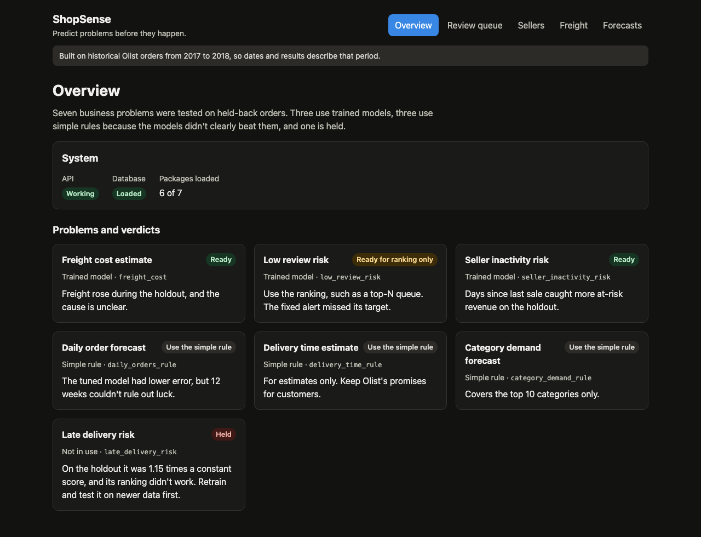
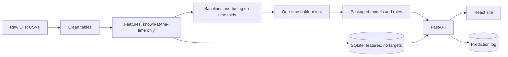

# ShopSense

**Predict problems before they happen.**

An end-to-end machine learning platform built on 99,441 Brazilian e-commerce orders from Olist. It tackles seven business problems, from late deliveries to freight costs. Each one went through time-based validation and a one-time holdout test before it was allowed near the website.



## Results

Every model was tested once on held-back orders from June to August 2018. A model was used only if it clearly beat a simple rule.

| Problem | In use | Holdout result |
|---|---|---|
| Freight cost | Trained model | Mean error 5.61, against 8.20 for the best simple rule |
| Seller inactivity | Trained model | PR-AUC 0.609 against 0.569; alerts reached 59.5% precision against a 60% target |
| Low review risk | Trained model, for ranking only | PR-AUC 0.314 against 0.163; the fixed alert missed its target, so it's used as a ranked queue |
| Daily orders | Simple rule | The model's error was lower, but 12 weeks of data couldn't rule out luck |
| Delivery time | Simple rule | The rule beat the model, after deliveries sped up |
| Category demand | Simple rule | The rule beat the model |
| Late delivery | **Held** | Only 1.15 times better than a constant guess, and its ranking didn't work |

Three trained models, three simple rules, and one held model is a more honest result than seven claimed wins. The reasons are in [`docs/project_summary.md`](docs/project_summary.md).

## How it fits together



## Run it with Docker

You need [Docker](https://www.docker.com/) and the built models and database. See "Build from the data" below.

```bash
docker compose up --build
```

Open http://localhost:8088. The API docs are at http://localhost:8088/api/docs. Set `SHOPSENSE_PORT` to use another port.

The image holds code only. Your models and database are attached from `models/` and `data/processed/` when it runs, and are never copied in. The app listens on your computer only, because it has no login.

## Build from the data

1. Download the Olist dataset and put its 9 CSV files in `data/raw/olist/`. Data isn't committed to git. Check the dataset's licence before sharing anything built from it.
2. Install [uv](https://docs.astral.sh/uv/) and Node 24, then:

```bash
uv sync
uv run python -m src.data.make_dataset       # clean tables
uv run python -m src.features.make_features  # features
uv run python -m src.models.package          # models and rules, using frozen settings
uv run python -m src.db.load                 # database
```

Rerunning `src.models.run_baselines` and `src.models.tune` (about 6 minutes) is optional. Their results are already in `reports/`. The holdout test in `src.models.evaluate` has already been used, and refuses to repeat.

## Develop

```bash
uv run uvicorn api.main:app --reload       # API at http://127.0.0.1:8000
cd frontend && npm install && npm run dev  # site at http://localhost:5173
```

If port 8000 is taken, run the API with `--port 8010` and start the site with `SHOPSENSE_API_URL=http://127.0.0.1:8010 npm run dev`.

After changing the API, regenerate the frontend's types with `uv run python -m api.export_openapi`, then `cd frontend && npm run generate:api`.

## Check it

```bash
scripts/check_all.sh            # lint, all tests, type checks, build, and browser tests
scripts/check_all.sh --rebuild  # also rebuild from raw data and confirm identical answers
```

GitHub Actions runs every check that doesn't need the data on each push.

## Documentation

| Topic | Where |
|---|---|
| What each model does, and its limits | [`docs/model_cards.md`](docs/model_cards.md) |
| Retraining on new data | [`docs/retraining.md`](docs/retraining.md) |
| Decisions, mistakes caught, and lessons | [`docs/project_summary.md`](docs/project_summary.md) |
| Every score | [`reports/model_comparison.md`](reports/model_comparison.md) |
| Known limitations | [`docs/limitations.md`](docs/limitations.md) |
| Notes from each phase | `docs/phase_00_setup.md` to `docs/phase_13_deployment.md` |

## Stack

Python 3.13 and uv, pandas, scikit-learn, FastAPI, SQLite and SQLAlchemy, React, Vite, and TypeScript, TanStack Query, Recharts, pytest, Vitest, Playwright, Docker, and GitHub Actions.
